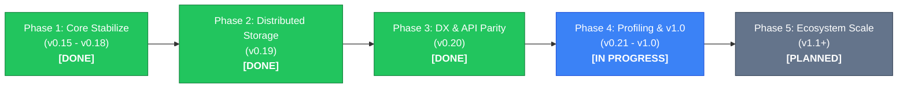

# TGWrapper Public Platform Roadmap

This document outlines the architectural phases, delivery milestones, and development priorities for the TGWrapper Telegram platform.

---

## 🗺️ Roadmap Overview

---

## 📅 Timeline & Milestone Matrix

| Phase | Milestone | Focus Areas | Key Deliverables | Status |
| :--- | :--- | :--- | :--- | :--- |
| **Phase 1** | v0.15 – v0.18 | Core Stabilize & Reliability | Zero-dependency bot kernel, FSM, dual ESM/CJS, Redis CAS, failsafe memory fallback | ✅ **Completed** |
| **Phase 2** | v0.19 | Multi-Engine Distributed State | DynamoDB adapter, MongoDB adapter, middleware pipeline (`useMiddleware`), webhook debugger UI | ✅ **Completed** |
| **Phase 3** | v0.20 | Telegram API Parity & Observability | Telegram Bot API 8.x schema sync, TMA cryptographic validation (`crypto.timingSafeEqual`), Stars/Payments, OpenTelemetry SDK integration | ✅ **Completed** |
| **Phase 4** | v0.21 – v1.0 | Profiling, Benchmarks & Hardening | Memory leak profiling hooks, CPU flamegraphs, benchmark dashboard, local webhook simulator, API freeze | 🔄 **Active** |
| **Phase 5** | v1.1+ | Extended Ecosystem & Edge Scale | PostgreSQL/SQLite CAS adapters, sliding-window rate limiters, Deno Deploy/Bun edge presets, visual FSM builder | 📋 **Planned** |

---

## 🎯 Phase Deep Dives

### Phase 1: Core Stabilize & Reliability (Shipped)
- **Zero-Dependency Core:** Lean serverless execution kernel adhering strictly to package size budgets.
- **Dual Module Output:** Strict ECMAScript Modules (`dist/`) and CommonJS (`dist-cjs/`) builds.
- **Redis CAS Session Management:** Atomic compare-and-swap state synchronization preventing race conditions in horizontally scaled bot topologies.
- **Fail-Safe Architecture:** `FailsafeSessionStorage` enabling automatic memory fallback during Redis degradation.
- **Automated Telegram Schema Drift Gates:** Daily CI monitoring against upstream Telegram Bot API specifications.

### Phase 2: Multi-Engine Distributed State (Shipped)
- **DynamoDB Adapter (`@tgwrapper/adapter-dynamodb`):** Enterprise AWS deployment support with CAS via conditional writes.
- **MongoDB Adapter (`@tgwrapper/adapter-mongodb`):** Document store support with versioned atomic updates via `findOneAndUpdate`.
- **Composable Middleware Pipeline:** Global, per-command, and per-state before/after hooks.
- **Live Webhook Debugger:** Opt-in inspection dashboard displaying raw payloads, execution timings, and headers.

### Phase 3: Modern Telegram Capabilities & Observability (Shipped)
- **Telegram Mini Apps Support (`./tma`):** Secure `initData` validation with constant-time HMAC comparison.
- **Digital Goods & Telegram Stars (`./payments`):** Full invoice creation, pre-checkout query handling, and successful payment processing.
- **First-Party OpenTelemetry Integration (`@tgwrapper/observability`):** Semantic conventions for Telegram update handling, distributed context propagation via `AsyncLocalStorage`, and Prometheus metrics exports.

### Phase 4: Profiling, Benchmarks & v1.0 Readiness (Current Focus)
- **Memory Profiling Hooks:** Non-invasive heap snapshot capture and memory growth telemetry for high-throughput webhook workers.
- **Flamegraph Profiling Tooling:** Integrated profiling scripts to generate CPU flamegraphs during peak load testing.
- **Automated Benchmark Dashboard:** GitHub Pages regression tracking for updates-per-second (UPS) across releases.
- **Local Webhook Simulator:** Offline development CLI to simulate incoming Telegram updates without third-party reverse proxies.
- **Final v1.0 API Stability Lock:** API freeze across core exports in preparation for long-term support (LTS).

### Phase 5: Extended Ecosystem & Edge Scale (Planned)
- **Relational Storage Adapters:** `@tgwrapper/adapter-postgres` and `@tgwrapper/adapter-sqlite`.
- **Edge Runtime Presets:** Native configuration templates for Deno Deploy, Fastly Compute, and Bun.
- **Visual State Machine Designer:** Web UI to design and export validated FSM definitions.
- **Plugin Registry:** Community ecosystem for reusable auth, moderation, and billing middlewares.
